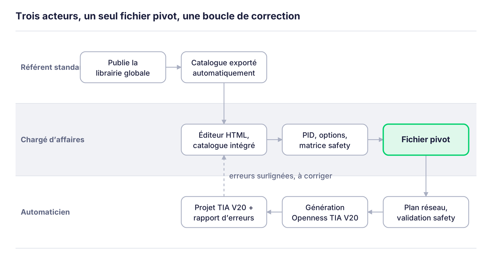
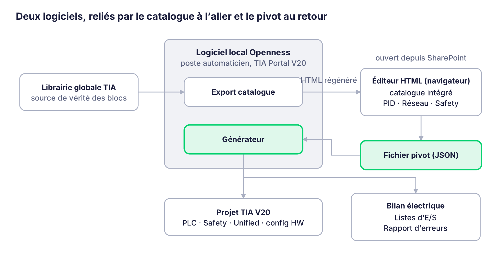
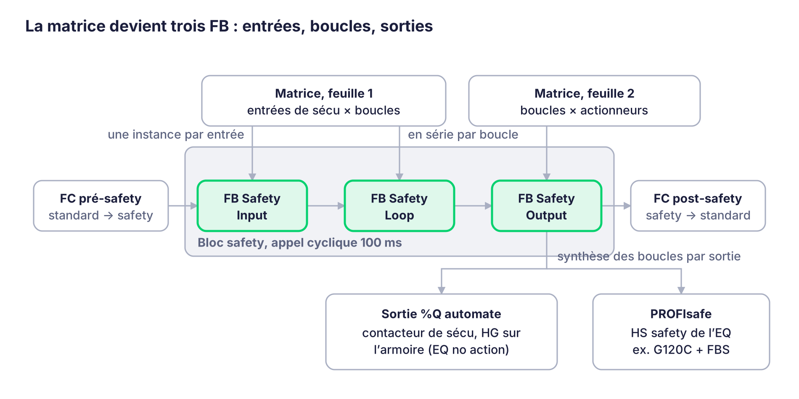
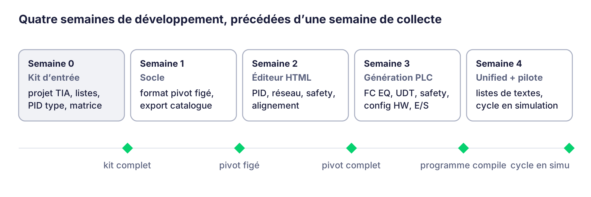

# Générateur TIA depuis PID — Cahier des charges technique

*Rédigé le 19/10/2026 – ALH. Version de référence : les Word dans `docs/word/`.*

## 1. Objectif et périmètre

Objectif : à partir du PID dessiné par le chargé d'affaires, générer en un clic un projet TIA Portal V20 complet, conforme au standard Aktid, qui compile et démarre.

Périmètre V1, livré en une seule génération (un équipement est créé complet, côté automate et côté supervision) :

- Programme automate : un FC par équipement avec ses HS, HG, CH et le réseau FU natif ; UDT channel câblés selon les liens du PID.

- Programme safety : FB Safety Input, Loop et Output générés depuis la matrice de sécurité, FC pré et post safety, DB Data to Safety.

- WinCC Unified : synoptique 1920×1080 reprenant le diagramme, pop-up de pilotage par équipement, listes de textes, alarmes et variables SCADA.

- Configuration matérielle : CPU (S7-1517 ou 1515 F), appareils Profinet, adresses IP dans les plages réservées, liste des réseaux.

- Listes d'entrées-sorties, déduites des HS.

- Bilan électrique, partie automatisme (les deux tiers du document).

Hors V1 :

| Sujet                                                      | Quand                                                       |
|------------------------------------------------------------|-------------------------------------------------------------|
| FU et smart régulations, vue de montage no-code            | Version 2                                                   |
| Réorganisation automatique du diagramme                    | Version 2 ; alignement et espacement restent en V1          |
| Export Visio du plan réseau                                | Version 2                                                   |
| Connecteur SharePoint ou Microsoft Graph pour le catalogue | Version 2, seulement si le catalogue intégré ne suffit plus |
| Import des trois anciens sites programmés à la main        | Backlog, pas sûr d'être développé                           |
| Fonctions spécifiques site (réseau FU, OB de régulations)  | Jamais générées : codées à la main dans des zones protégées |

## 2. Acteurs et flux de bout en bout

Trois personnes interviennent, à trois moments, sur trois outils différents ; le fichier pivot fait le pont entre elles.

*flux de bout en bout · 3 acteurs, 8 étapes, 1 boucle de correction*

La boucle en pointillé est le retour vers le chargé d'affaires : les erreurs de génération renvoient à l'élément en cause dans son fichier, surligné en rouge.

| Acteur            | Fait                                                                                                     | Outil                                               |
|-------------------|----------------------------------------------------------------------------------------------------------|-----------------------------------------------------|
| Référent standard | Publie la librairie globale ; le catalogue se régénère sans action manuelle                              | TIA Portal V20 + logiciel local                     |
| Chargé d'affaires | Dessine le PID, choisit les natures métier et les options, coche la matrice de sécurité                  | Éditeur HTML, dans le navigateur, sans installation |
| Automaticien      | Complète le plan réseau, valide la safety, lance la génération, arbitre les conflits, code le spécifique | Logiciel local Openness sur son poste TIA           |

## 3. Architecture

Deux logiciels séparés par usage, personne et moment, reliés par deux fichiers : le catalogue à l'aller, le pivot au retour.

*architecture cible · 2 logiciels, 1 pivot, 1 catalogue*

- Éditeur HTML : un seul fichier, ouvert depuis SharePoint dans le navigateur, sans installation. Il embarque le catalogue et produit le pivot. Aucun connecteur SharePoint ni Microsoft Graph en V1.

- Logiciel local Openness : installé sur le poste de l'automaticien et du référent standard, là où TIA Portal V20 est présent. Deux fonctions : exporter le catalogue depuis la librairie globale (et régénérer le HTML), et générer le projet à partir d'un pivot.

- Environnement figé : tout le monde sur TIA V20. Un rétrofit sur version ancienne migre le projet en V20 plutôt que de supporter plusieurs versions.

- Le pivot est interne : l'utilisateur ne le manipule jamais directement, il ouvre l'éditeur ou le générateur.

## 4. Modèle de données du standard

Tout repose sur cinq objets du standard Aktid : l'équipement EQ, ses hardware génériques HG, les hardware spécifiques HS, les canaux CH et les fonctions FU. Le générateur n'invente aucune logique : il instancie ces blocs et les câble.

| Objet      | Rôle                                                                                                                                                | Cardinalité et règles                                                                                                                          |
|------------|-----------------------------------------------------------------------------------------------------------------------------------------------------|------------------------------------------------------------------------------------------------------------------------------------------------|
| EQ         | Un équipement du PID ; un FC par équipement dans le programme. Porte le repère client (nomme les blocs TIA), le repère Aktid et un descriptif libre | Un par objet posé sur le PID. Les armoires électriques sont des EQ « no action »                                                               |
| HG         | Hardware générique : brique fonctionnelle (BELT, OPSO, MRS, DRIV, KM, Q, QM, SWDI, ESTO, SG, LT, WT…)                                               | Pile ordonnée par EQ, jusqu'à 23. HG0 = ce qui touche la matière, fixé par la nature métier choisie                                            |
| HS         | Hardware spécifique : le bloc constructeur derrière un HG (ex. G120C, SEW DFC) ; porte la liste d'IO                                                | Un HS par HG. Un HS safety jumeau (ex. FBS) si l'équipement a des échanges PROFIsafe ; un HG d'entrée de sécu n'a son HS que côté safety       |
| CH         | Canal : un endroit où la matière vit ; porte les asservissements via des UDT d'échange standard                                                     | 1 à 3 par EQ. Chaque canal : jusqu'à 6 sorties en marche avant et 6 en marche arrière, chacune reliée au canal d'un autre EQ                   |
| Setpoints  | Consignes pilotées par les FU                                                                                                                       | Jusqu'à 4 par EQ, découlent des HG                                                                                                             |
| Options EQ | Pattes d'entrée du bloc EQ, paramétrées en dur                                                                                                      | Autorisation de marche arrière, first channel, type bypass, bypass des asservissements au démarrage, et les autres pattes exposées par le bloc |
| FU         | Fonctions greffées sur un setpoint (PID, régression linéaire, forçages, combinés)                                                                   | Version 2 ; seules les fonctions natives sont instanciées en V1                                                                                |

Règles d'empilement des HG, décrites dans la liste SharePoint des « supérieurs » : pour chaque HG, la liste de ce qui peut se poser au-dessus. Exemple : BELT, puis MRS synchrone ou asynchrone, puis DRIV, SOFT ou KM, puis Q ou QM ; un SWDI peut s'intercaler entre KM et MRS. Le chaînage se fait par flux typés : Q, KM et DRIV sortent une ElectricalValue (400 V, Hz), MRS la convertit en MechanicalValue (tr/min en sortie de réducteur), BELT la convertit en m/min via le diamètre de rouleau.

Le chargé d'affaires ne manipule pas les HG électriques : il choisit la nature métier (trieur optique, tapis transitique, tapis bypass, crible balistique…), le type de moteur et le variateur ou démarreur. L'éditeur pose le HG0 et les HG supérieurs par défaut d'après cette liste (un crible balistique reçoit nativement un Q), et propose un choix en cas de doute. Il peut ensuite ajouter des HG de proximité : arrêt d'urgence coup de poing, sonde de niveau.

Règles d'options déduites : first channel coché automatiquement si aucune sortie n'arrive dans le canal ; marche arrière grisée si le HG de commande est un KM. Les autres options sont listées depuis l'interface du bloc EQ exportée dans le catalogue, visibles dans la pop-up de l'équipement, modifiables par le chargé d'affaires ou l'automaticien.

## 5. Éditeur synoptique HTML

Un seul fichier HTML, catalogue intégré, ouvert dans le navigateur depuis le dossier SharePoint, sans rien installer. Le fichier peut peser plusieurs mégaoctets, ce n'est pas un problème.

Trois onglets, qui lisent et écrivent le même fichier pivot :

1.  PID : le synoptique de la ligne.

2.  Réseau : armoires, switchs, sous-réseaux ; renseigné par l'automaticien, qui peut y repasser après le chargé d'affaires.

3.  Matrice de sécurité : deux feuilles, lignes pré-remplies depuis le PID (section 9).

Onglet PID, interactions :

- Réglages de base au démarrage du projet : l'éditeur part des standards Aktid (ex. tous les variateurs en Siemens G120C) ; le chargé d'affaires ajuste ces choix une fois, chaque nouvel équipement les prend, puis modification au cas par cas en cliquant sur l'équipement (ex. ces deux variateurs en SEW DFC), notamment pour les HS.

- Création d'un équipement : choix de la nature métier, qui fixe le HG0 et la pile de HG par défaut ; repère client, repère Aktid, descriptif.

- Petits « + » sur l'équipement, sans menu : un « + » à l'intérieur ajoute un canal (jusqu'à 3) ; chaque « + » en bord côté marche avant ou marche arrière est une sortie du canal ; cliquer dessus crée l'équipement suivant déjà raccordé et pré-rempli. Un nouveau « + » apparaît à côté jusqu'à 6 sorties par sens.

- Chaque sortie est un objet nommé du pivot (canal, numéro, sens, positif ou négatif). La forme dessinée ne porte aucune information : rond, triangle ou rectangle selon le client, les points de sortie se posent sur le contour et une étiquette au survol dit de quelle sortie il s'agit.

- Pop-up de l'équipement : pile de HG, HS, options du bloc EQ, setpoints, HG de proximité à ajouter.

- Alignement et espacement dès la V1 : sélection multiple, aligner à gauche, centrer, aligner en haut, répartir horizontalement ou verticalement. La réorganisation automatique complète est une option de V2.

- Une ligne tient dans un seul écran 1920×1080 ; la disposition de l'éditeur est reprise telle quelle dans la vue Unified.

Version du catalogue : l'éditeur affiche la date du catalogue intégré et un message demandant de vérifier qu'on utilise la dernière version ; le pivot enregistre la version utilisée, que le générateur vérifie avant de générer. La parade aux copies locales périmées : toujours ouvrir le fichier depuis le même dossier SharePoint.

## 6. Catalogue

Le catalogue est exporté automatiquement depuis la librairie globale TIA par le logiciel local, dès que le référent standard publie ; la librairie reste la seule source de vérité sur le contenu des blocs. L'export régénère directement le fichier HTML complet de l'éditeur, avec le catalogue dedans.

Contenu du catalogue :

| Donnée                                                                 | Source                                    | Sert à                                                         |
|------------------------------------------------------------------------|-------------------------------------------|----------------------------------------------------------------|
| Liste des HG et HS, avec leurs versions                                | Librairie globale TIA                     | Pile de HG, choix des HS dans l'éditeur                        |
| Interface du bloc EQ (pattes d'entrée)                                 | Librairie globale TIA                     | Options par équipement exposées dans la pop-up                 |
| Échanges SCADA par HG (ex. LT .Measurement.Level.Net, WT pesage net)   | Librairie TIA (aujourd'hui dans un Excel) | Entrées des FU en V2, variables Unified                        |
| Liste d'IO de chaque HS                                                | Blocs de la librairie                     | Listes d'E/S, bilan électrique                                 |
| HS safety jumeau par HS (ex. G120C → FBS)                              | Librairie TIA                             | Savoir si un actionneur est coupé en PROFIsafe ou par sortie Q |
| Règles des HG supérieurs                                               | Liste SharePoint                          | Pile de HG par défaut selon la nature métier                   |
| Plages d'adresses IP et %I / %Q réservées par type de HG               | Liste SharePoint                          | Adressage automatique et contrôle des recouvrements            |
| Index Unified par HG (listes de textes)                                | Liste SharePoint                          | Remplissage des listes de textes par équipement                |
| Natures métier (trieur optique, crible balistique, tapis…) et leur HG0 | Standard Aktid                            | Choix du chargé d'affaires à la création d'un équipement       |

Chaque export porte une date et une empreinte de version. Le pivot mémorise la version utilisée ; à la génération, un écart de version est signalé avant de continuer.

## 7. Fichier pivot

Le pivot est la colonne vertébrale du projet : un fichier JSON produit par l'éditeur, lu par le générateur, invisible pour l'utilisateur. Sa structure est figée en semaine 1 et ne bouge plus.

| Section             | Contenu                                                                                                                                                                                                           |
|---------------------|-------------------------------------------------------------------------------------------------------------------------------------------------------------------------------------------------------------------|
| En-tête             | Nom du site, version du catalogue utilisée, réglages de base du projet (variateur par défaut, CPU, etc.), date de dernière modification                                                                           |
| Équipements         | Par EQ : repère client, repère Aktid, descriptif, nature métier, type d'EQ (actif ou no action), position et forme sur le PID, pile ordonnée de HG avec leur HS, options du bloc EQ, setpoints, canaux et sorties |
| Liens               | Pour chaque sortie (EQ, canal, numéro, sens) : le canal de destination (EQ, canal)                                                                                                                                |
| Réseau              | Armoires, switchs, sous-réseaux, rattachement de chaque HG communicant ; adresses IP et plages %I / %Q attribuées                                                                                                 |
| Matrice de sécurité | Boucles (nom, PL informatif), feuille 1 entrées × boucles, feuille 2 actionneurs × boucles, statut de validation humaine                                                                                          |
| Empreintes          | Par équipement : empreinte des données du pivot, et empreinte ou date des blocs TIA relevée à la dernière génération                                                                                              |

Le repère client nomme les blocs dans TIA ; le « type » n'est qu'un descriptif libre, la nature de l'équipement vient du HG0. Le pivot d'un site reste le point d'entrée de tout rétrofit : on le rouvre dans l'éditeur, on modifie, on re-génère.

## 8. Génération du programme automate

Le générateur tourne sur le poste de l'automaticien, dans TIA Portal V20 via TIA Openness, et produit un FC par équipement, nommé par le repère client, avec toujours la même structure.

1.  Réseau 1 : tous les HS de l'équipement (jusqu'à 4 typiquement), instanciés depuis la librairie dans la version du catalogue.

2.  Réseau 2 : tous les HG, un par HS, dans l'ordre de la pile.

3.  Réseau 3 : les canaux CH, un à trois ; leurs UDT d'échange standard sont câblés entre chaque sortie et le canal de destination décrit dans les liens du pivot. C'est là que vivent les asservissements, déjà codés dans le standard.

4.  Réseau 4 : le bloc EQ, avec ses pattes d'entrée renseignées d'après les options du pivot (marche arrière autorisée, first channel, type bypass, bypass des asservissements au démarrage, etc.).

5.  Réseau 5, dit réseau FU : les fonctions natives de base qui pilotent les setpoints. Créé à la première génération, puis jamais retouché (section 14).

Règles de génération :

- Un équipement « no action » (armoire électrique) reçoit un FC avec ses HG de relais et contacteurs de sécurité, pour la localisation, le repère client et les alarmes et défauts.

- Les HG électriques déduits (Q, QM, SWDI…) sont générés comme les autres, depuis la pile complète du pivot.

- Les noms de blocs, instances et variables suivent les conventions du standard Aktid déjà en place dans la librairie ; le générateur ne crée aucune convention nouvelle.

- La génération crée aussi les appels dans l'OB principal et l'appel cyclique du programme safety.

- Ordre des travaux : configuration matérielle et réseaux, puis blocs équipements, puis safety, puis Unified, puis compilation complète et rapport.

La question ouverte de l'ordre d'appel des FC équipements dans l'OB (ordre du pivot, ordre des repères, ou sens du flux matière) est à trancher en semaine 1 avec le projet TIA exemple.

## 9. Safety

La matrice de sécurité reste purement fonctionnelle, quelle entrée coupe quelle boucle et quelle boucle met quel actionneur en sécurité ; la technique vient des HS, et la validation finale reste humaine.

*chaîne safety · 2 feuilles, 3 FB, 2 FC de recopie, 2 types de sorties*

Matrice, dans l'onglet Safety de l'éditeur :

- Feuille 1 : une ligne par entrée de sécu (ex. 04A-8 ESTO01, 24A-8 SG01), une colonne par boucle (ex. 400A arrêt d'urgence générale où tous les coups de poing sont raccordés, 400B accès trieur optique, 400C accès sous cabine), une croix quand l'entrée coupe la boucle. Les lignes sont pré-remplies depuis les HG de type safety posés sur le PID.

- Feuille 2 : mêmes colonnes de boucles au même emplacement, une ligne par actionneur, une croix quand la boucle le met en sécurité. Les lignes sont pré-remplies depuis les équipements du PID : pas d'équipement, pas d'actionneur.

- Le chargé d'affaires crée les colonnes de boucles et pose les croix. Le niveau de performance est une propriété de la boucle, informatif, sans effet sur la génération.

- Un humain valide obligatoirement la matrice avant génération : lui seul fait le lien avec l'analyse de risque. Le pivot porte ce statut de validation et le générateur refuse de générer la safety tant qu'il est absent.

Traduction en code :

- FB Safety Input : instances des blocs standard par type d'entrée (ESTO, safety gate, porte d'accès), une par ligne de la feuille 1.

- FB Safety Loop : pour chaque boucle, mise en série en ladder de toutes les entrées cochées dans sa colonne.

- FB Safety Output : pour chaque sortie, la synthèse des boucles qui la coupent, plusieurs boucles pouvant couper la même sortie.

- Autour, selon les bonnes pratiques Siemens : un FC pré-safety recopie les données non-safety vers le DB Data to Safety, lu par la safety ; un FC post-safety recopie en sens inverse les informations de la safety vers le programme standard.

Comment un actionneur est coupé, déduit des HS, sans colonne supplémentaire dans la matrice :

- Équipement avec HS safety jumeau (ex. G120C + FBS) : pilotage direct en PROFIsafe, le HS safety est appelé en parallèle dans la safety et rattaché à l'équipement, qui gère son propre défaut.

- Sinon : sortie %Q de sécu vers un contacteur de sécurité (ex. Schneider CAD) qui crée un 24 V ou 400 V de sécu pour un ou plusieurs équipements. Ces relais sont des HG rattachés à l'équipement armoire électrique, de type no action, pour la localisation, le repère client et les alarmes et défauts.

- Un HG d'entrée de sécu (ESTO, SG) n'a pas de HS côté non-safety ; son HS est déporté dans la partie safety.

## 10. Génération WinCC Unified

Tout existe déjà dans la librairie, faceplates comprises, et tout est dynamique : le travail du générateur côté Unified consiste surtout à remplir correctement les listes de textes.

- Synoptique : une seule vue 1920×1080 qui respecte la disposition de l'éditeur ; faceplates et formes des objets du PID, traits et liens entre équipements. Pour modifier la vue, on modifie dans l'éditeur puis on re-génère, plutôt que de retoucher dans Unified.

- Pop-up de pilotage : un clic sur un équipement ouvre sa pop-up, qui affiche ses HG visibles en supervision.

- Listes de textes : par équipement, le listing des HG avec les numéros et index venant du SharePoint ; ce sont elles qui font apparaître dynamiquement les HG dans les faceplates. La logique exacte des index sera documentée avec le projet exemple.

- Alarmes : générées par équipement à partir des HG, selon le standard.

- Variables SCADA : créées par équipement à partir des échanges SCADA des HG listés dans le catalogue.

La supervision est générée dans la même passe que l'automate : un équipement créé est complet des deux côtés, et le critère de réussite du pilote inclut un Unified qui compile et démarre.

## 11. Configuration matérielle, réseau et adressage

La V1 génère la configuration matérielle complète à partir de l'onglet Réseau de l'éditeur : le plan réseau doit donc être renseigné avant la génération, pas déduit d'elle.

- CPU : S7-1517 ou S7-1515 F, choisie dans les réglages de base du projet.

- Appareils Profinet : chaque HG communicant (variateur, trieur optique, îlot d'E/S…) est déclaré et raccordé à la CPU via le switch et le sous-réseau indiqués dans l'onglet Réseau.

- Adresses IP : attribuées automatiquement dans les plages réservées par type de HG d'après le listing SharePoint (ex. variateurs de .50 à .100), avec contrôle des recouvrements et de la réserve restante.

- Adresses %I et %Q : attribuées de la même façon, dans les plages réservées par type de HG.

- Liste des réseaux : produite avec le projet.

L'onglet Réseau remplace le Visio actuel de l'automaticien : armoires, switchs, sous-réseaux, et rattachement de chaque HG communicant à une armoire. L'export Visio viendra en V2. Les relais et contacteurs de sécurité sont rattachés à l'équipement armoire correspondant, ce qui donne leur localisation et leur repère.

## 12. Listes d'E/S et bilan électrique

Les deux documents sont des sous-produits de la génération : si le programme est créé, ils le sont aussi, dans la même passe.

- Listes d'entrées-sorties : chaque HS porte sa liste d'IO, exportée des blocs de la librairie via le catalogue ; la liste du site est la concaténation par équipement, avec les adresses %I / %Q attribuées en section 11.

- Bilan électrique : le pivot ressemble déjà aux deux tiers « automatisme » du bilan (équipements en lignes, HG en colonnes, HS associés). Le générateur produit cette partie ; le tiers restant, purement électrique, reste à compléter par l'électricien.

Format de sortie : Excel pour les deux, dans la mise en page des documents actuels, à fournir dans le kit d'entrée.

## 13. Erreurs, re-génération et conflits

La génération ne s'arrête jamais sur une erreur individuelle : elle continue en arrière-plan, puis rend un rapport qui renvoie à l'élément en cause.

- Erreurs : chaque élément qui n'a pas pu être généré (bloc manquant dans la librairie, information absente, bug) est listé et pointé dans le fichier du chargé d'affaires, surligné en rouge, pour pouvoir lui renvoyer directement.

- Re-génération après aller-retour : équipement inchangé, rien ; nouveau, créé ; modifié, mis à jour et tracé.

- Équipement absent du nouveau pivot : jamais supprimé d'office. En fin de génération, liste des équipements manquants avec choix supprimer ou conserver, façon boîte de dialogue Windows (oui pour tous, non pour tous, au cas par cas). Cela permet les patchs partiels, par exemple ajouter quatre équipements seulement.

- Double détection des changements : empreinte des données du pivot (ce que le chargé d'affaires a changé) et empreinte ou date des blocs TIA relevée à la génération (ce que l'automaticien a retouché à la main).

- Conflit : si les deux ont bougé sur le même équipement, le logiciel pose la question et l'automaticien choisit, garder sa retouche ou l'écraser avec la version du chargé d'affaires.

- Les empreintes TIA ne portent que sur les réseaux 1 à 4 du FC équipement ; le réseau FU et l'OB de régulations sont hors détection et hors écriture (section 14).

- Plantage technique en cours de génération (TIA, Openness) : distinct de la logique métier ci-dessus ; comportement à fixer en semaine 1, le plus simple étant de rejouer la génération complète, qui est idempotente par construction.

Rétrofit : un site déjà généré par l'outil se reprend par son pivot dans l'éditeur. Les trois anciens sites programmés à la main ne sont pas repris en V1.

## 14. Spécifiques : zones que le générateur ne touche pas

Deux niveaux de spécifique existent dans un site, et la V1 n'en génère aucun : le générateur crée la zone vide ou native, puis ne la réécrit jamais.

| Niveau                          | Où                                    | Contenu                                                                                                                                                               | Qui          | Comportement du générateur                                                        |
|---------------------------------|---------------------------------------|-----------------------------------------------------------------------------------------------------------------------------------------------------------------------|--------------|-----------------------------------------------------------------------------------|
| Fonction locale à un équipement | Réseau 5 (réseau FU) du FC équipement | Petites fonctions propres à l'équipement, ex. ralentir temporairement un tapis                                                                                        | Automaticien | Créé à la première génération avec les fonctions natives, jamais retouché ensuite |
| Smart régulation complète       | OB dédié, un FC par régulation        | Régulations qui pilotent un ou plusieurs équipements, lisent plusieurs instrumentations, font des montages ; écrites en FBD ou CFC pour voir les traits et la cascade | Automaticien | Hors V1 ; correspondra à la vue de montage des FU en V2                           |

Règle de protection : le générateur écrit uniquement les réseaux 1 à 4 des FC équipements, le programme safety, la configuration matérielle et les objets Unified qu'il a créés. Tout bloc ou réseau hors de cette liste est ignoré, y compris à la re-génération et dans la détection de conflits.

## 15. Cas pilote et critères de réussite

Le pilote est un projet de test 100 % standard, sans aucun spécifique, construit pour couvrir à peu près tous les HG et les cas de figure courants.

Contenu du site de test :

- Équipements à plusieurs sondes et équipements à une seule sonde.

- Quelques arrêts d'urgence, pas trop, et au moins une porte d'accès, pour exercer la matrice de sécurité.

- Asservissements entre équipements, plusieurs entrées de ligne (first channel), plusieurs sorties, et des boucles qui rebouclent sur elles-mêmes.

- Au moins un équipement multicanal et un équipement avec marche arrière.

Critère de réussite, binaire :

- [ ] Depuis le PID, un clic sur « générer » produit un projet TIA V20 sans intervention manuelle.

- [ ] Le WinCC Unified compile et démarre.

- [ ] Le programme automate compile et démarre.

- [ ] Tout mis en simulation, un cycle de ligne se lance en activant manuellement le bit de simulation dans le programme.

Tant que les quatre cases ne sont pas cochées sur le site de test, l'outil n'est pas utilisé sur une affaire réelle.

## 16. Découpage et planning sur un mois

Vingt jours de travail, quatre lots livrables séparément, et une règle : Alex ne code pas, il fournit les exemples et valide, Claude Code écrit le logiciel.

*découpage sur 20 jours de travail · 4 lots + 1 semaine de collecte, date de démarrage à fixer*

Chaque lot se termine par une porte : tant qu'elle n'est pas franchie, le lot suivant ne démarre pas.

1.  Semaine 0, collecte, avant le jour 1 : rassembler le kit d'entrée de la section 17. Sans lui, rien ne démarre.

2.  Semaine 1, socle : figer le format pivot, construire l'export du catalogue depuis la librairie globale et la régénération du HTML, poser le squelette du générateur Openness sur le projet exemple. Trancher les points ouverts de la section 18 prévus en semaine 1.

3.  Semaine 2, éditeur HTML : onglet PID avec équipements, canaux, sorties, pop-up d'options, réglages de base, alignement et espacement ; onglets Réseau et Safety avec pré-remplissage. Porte : un pivot complet produit sur le site de test.

4.  Semaine 3, génération automate : FC par équipement, câblage des UDT channel, bloc EQ et options, programme safety, configuration matérielle et adressage, listes d'E/S, bilan électrique, rapport d'erreurs, re-génération et conflits. Porte : le programme compile.

5.  Semaine 4, Unified et pilote : synoptique, pop-ups, listes de textes, alarmes et variables ; puis le site de test jusqu'à ce que les quatre cases de la section 15 soient cochées.

Rythme de travail : Claude Code avance en autonomie dans la journée, Alex valide en fin de journée sur le projet exemple et corrige le cap. Le risque principal est la semaine 0 : si les exemples arrivent tard, tout le reste glisse d'autant.

## 17. Kit d'entrée à fournir avant le jour 1

Sans ces exemples réels le premier jour, Claude Code devine les règles au lieu de les apprendre, et tout glisse. La semaine 0 leur est consacrée.

- [ ] Un vrai projet TIA V20 exporté, avec au moins un équipement de chaque nature métier, un équipement multicanal, une armoire « no action » et le programme safety complet (FC pré et post, DB Data to Safety, les trois FB).

- [ ] La librairie globale, ou son export, pour construire le catalogue : HG, HS, HS safety jumeaux, interface du bloc EQ, listes d'IO, échanges SCADA.

- [ ] Extrait des listes SharePoint : règles des HG supérieurs, natures métier et leur HG0, plages d'adresses IP et %I / %Q par type de HG, index Unified des listes de textes, versions des blocs.

- [ ] Un PID type d'une ligne récente, dans la forme que les chargés d'affaires produisent aujourd'hui.

- [ ] Une matrice de sécurité Excel réelle, avec ses deux feuilles.

- [ ] Le Visio du plan réseau d'un site, pour l'onglet Réseau.

- [ ] Un bilan électrique et une liste d'E/S d'un site, comme modèles de mise en page.

- [ ] L'Excel actuel des échanges SCADA par HG.

- [ ] Le projet Unified correspondant, pour la logique des listes de textes et des faceplates.

- [ ] La liste des formes d'équipements utilisées par les clients (cercles, rectangles) avec un exemple de chaque.

## 18. Points ouverts et backlog

Les grandes décisions sont prises ; il reste des points de détail à trancher en semaine 1 avec les exemples en main, et un backlog pour la suite.

| Point                                                                                           | À trancher                                                              | Par qui, quand  |
|-------------------------------------------------------------------------------------------------|-------------------------------------------------------------------------|-----------------|
| Ordre d'appel des FC équipements dans l'OB                                                      | Ordre du pivot, des repères, ou du flux matière                         | Alex, semaine 1 |
| Comportement sur plantage technique de TIA ou Openness en cours de génération                   | Rejouer la génération complète, ou reprendre au dernier équipement      | Alex, semaine 1 |
| Options visibles par le chargé d'affaires dans la pop-up, et options réservées à l'automaticien | Liste par patte du bloc EQ                                              | Alex, semaine 2 |
| Nommage des boucles de sécurité dans l'onglet matrice                                           | Libre, ou imposé 400A, 400B…                                            | Alex, semaine 2 |
| Représentation des sorties sur un équipement rond                                               | Points sur le pourtour avec étiquette au survol, à valider sur maquette | Alex, semaine 2 |
| Logique exacte des index Unified dans les listes de textes                                      | À documenter à partir du projet exemple                                 | Alex, semaine 4 |

Backlog, hors V1 :

- Documents de la phase REA produits par l'éditeur, à terme tous (noté par Alex le 21/10/2026) :
  - matrice de sécurité, publiée sur le portail instrumentations contrôle commande ;
  - bilan électrique, publié sur le portail instrumentations contrôle commande ;
  - AF (analyse fonctionnelle) ;
  - schéma électrique ;
  - organigramme réseau ;
  - listing machine (ABI) ;
  - liste des adresses IP ;
  - manuel utilisateur.

- Vue de montage des FU : une feuille par régulation, blocs PID, combiné, forçages, cascade et parallèle, entrées choisies dans les échanges SCADA des HG.

- Réorganisation automatique du diagramme.

- Export Visio du plan réseau.

- Connecteur SharePoint ou Microsoft Graph pour lire le catalogue sans régénérer le HTML.

- Import des trois anciens sites faits à la main, mode « prise en charge » : pas sûr d'être développé un jour.

## 19. Glossaire

| Terme              | Signification                                                                                               |
|--------------------|-------------------------------------------------------------------------------------------------------------|
| PID                | Schéma de la ligne (équipements et flux matière) dessiné par le chargé d'affaires                           |
| EQ                 | Équipement : un FC par équipement dans le programme                                                         |
| HG                 | Hardware générique, brique fonctionnelle du standard ; HG0 = celui qui touche la matière                    |
| HS                 | Hardware spécifique, bloc constructeur derrière un HG                                                       |
| CH                 | Canal : endroit où la matière vit dans un équipement ; porte les sorties et les asservissements             |
| FU                 | Fonction greffée sur un setpoint (PID, régression, forçages)                                                |
| UDT channel        | Type de données standard d'échange entre canaux                                                             |
| No action          | Équipement sans action process, ex. armoire électrique, support de HG de localisation et d'alarmes          |
| First channel      | Option d'un canal en tête de ligne, dans lequel personne ne jette                                           |
| Type bypass        | Option d'équipement dont le sens de marche se règle en recette                                              |
| ESTO, SG           | Arrêt d'urgence, safety gate (porte d'accès)                                                                |
| Boucle de sécurité | Colonne de la matrice (400A, 400B…) ; coupée par des entrées, met des actionneurs en sécurité ; porte un PL |
| PL                 | Performance level de la boucle, informatif pour la génération                                               |
| FBS                | FB de safety associé à un HS pour les échanges PROFIsafe                                                    |
| Pivot              | Fichier JSON échangé entre l'éditeur et le générateur                                                       |
| Catalogue          | Export de la librairie globale intégré dans l'éditeur HTML                                                  |
| TIA Openness       | API de Siemens pour piloter TIA Portal par programme                                                        |
| Claude Code        | Assistant de codage IA qui écrit le logiciel à partir des exemples et des validations d'Alex                |
