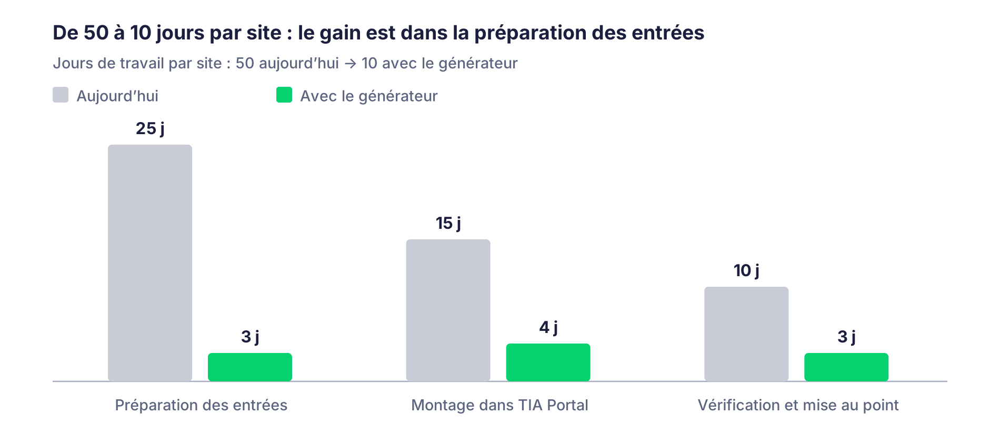

# Générateur TIA depuis PID — Dossier business

*Rédigé le 19/10/2026 – ALH. Version de référence : les Word dans `docs/word/`.*

## Le constat

Un site standard coûte aujourd'hui 2 à 3 mois d'automaticien, soit 40 à 60 jours, et l'essentiel part dans la préparation des entrées, pas dans le code.

Pour écrire un bon programme, il faut d'abord réunir trois documents, aujourd'hui produits et corrigés à la main :

- Le bilan électrique : fourni en entrée, mais à repasser systématiquement.

- La matrice de sécurité : un Excel à deux feuilles, souvent mal fait, source récurrente de gros problèmes.

- L'organigramme réseau : construit sur Visio par l'automaticien.

Une fois ces entrées justes, le programme et la supervision sont un montage de blocs standard, de la recopie dans TIA Portal. Le temps se perd donc à réconcilier trois fichiers qui ne se parlent pas, et à refaire ce que le PID du chargé d'affaires contenait déjà.

## La solution

Le chargé d'affaires dessine le PID dans un éditeur web, clique sur « générer », et obtient un projet TIA Portal complet qui compile et démarre : programme automate, supervision WinCC Unified, programme de sécurité, configuration matérielle, listes d'entrées-sorties et bilan électrique, tous issus de la même source.

Deux logiciels, et rien à installer pour le chargé d'affaires :

- Un éditeur de synoptique en HTML, ouvert depuis SharePoint dans le navigateur, qui connaît le catalogue des blocs standard Aktid.

- Un générateur local sur le poste de l'automaticien, qui pilote TIA Portal V20 par TIA Openness et assemble le projet.

Le générateur n'invente rien : il instancie les blocs de la librairie globale, qui reste la seule source de vérité. Quand le référent standard publie une nouvelle version, le catalogue de l'éditeur se met à jour sans action manuelle.

## Gain par site

Un site standard passe d'environ 50 jours à environ 10, soit 40 jours gagnés par site, parce que la préparation des entrées disparaît presque entièrement.

*estimation Alex, octobre 2026 · répartition à affiner, total actuel constaté de 2 à 3 mois*

Le dessin du PID n'est pas un coût nouveau : le chargé d'affaires le fait déjà aujourd'hui, il le fait simplement dans l'éditeur. La répartition des 50 jours est une estimation à confirmer sur le dernier site livré ; le total de 2 à 3 mois, lui, est constaté.

## Gain annuel

L'outil est amorti dès le premier site : il coûte 20 jours à développer et en fait gagner environ 40 par site.

| Sites générés par an | Jours gagnés (à 40 j/site) | Équivalent temps plein automaticien (base 200 j/an) |
|----------------------|----------------------------|-----------------------------------------------------|
| 2                    | 80                         | 0,4                                                 |
| 4                    | 160                        | 0,8                                                 |
| 6                    | 240                        | 1,2                                                 |

Le nombre de sites par an reste à renseigner par Aktid pour figer le chiffre ; les trois lignes donnent l'ordre de grandeur.

## Gains non chiffrés

Le gain le plus durable n'est pas le temps, c'est la fin des trois fichiers à réconcilier : le PID devient la source unique, et tout le reste en découle.

- Cohérence par construction : bilan électrique, matrice de sécurité, plan réseau, programme et supervision sont déduits du même PID.

- Moins d'erreurs de saisie : les lignes de la matrice de sécurité sont pré-remplies depuis le PID, l'humain ne fait plus que cocher et valider.

- Le standard Aktid s'applique à 100 % sur chaque site, quelle que soit la personne qui génère.

- Le chargé d'affaires devient autonome pour produire un PID exploitable, sans TIA Portal et sans installation.

- Une modification en cours d'affaire se répercute partout en une re-génération, tracée, sans écraser les retouches de l'automaticien.

- La validation de sécurité reste humaine, en lien avec l'analyse de risque : l'outil supprime la saisie, pas la responsabilité.

## Investissement

Un mois, soit 20 jours de travail d'Alex, sans ressource externe ni licence supplémentaire identifiée.

- Développement avec Claude Code, un assistant de codage IA : Alex fournit les exemples réels et valide, l'outil écrit le code.

- Environnement déjà en place : TIA Portal V20 sur tous les postes, TIA Openness fourni avec TIA Portal, SharePoint pour héberger l'éditeur.

- Standards figés : la librairie de blocs Aktid est stable, aucune refonte à financer.

- Prérequis avant le jour 1, une semaine de collecte : un projet TIA exemple, un extrait des listes SharePoint (HG, HS, règles d'empilement, plages d'adresses), un PID type et une matrice de sécurité Excel.

- Pilote : un site de test 100 % standard. Succès si le programme et la supervision compilent et démarrent, et si un cycle de ligne tourne en simulation.

Les régulations avancées (FU) et les sites avec du spécifique restent codés à la main comme aujourd'hui ; ils viendront dans une version 2.

## Risques et parades

Le risque principal est le démarrage : sans les exemples réels le premier jour, tout glisse.

| Risque                                                      | Parade                                                                                                                            |
|-------------------------------------------------------------|-----------------------------------------------------------------------------------------------------------------------------------|
| Exemples réels fournis en retard                            | Semaine de collecte dédiée avant le jour 1 ; rien ne démarre sans le kit complet                                                  |
| Sites avec du spécifique que le générateur ne couvre pas    | Zones réservées dans le programme, jamais écrasées ; le spécifique reste codé à la main comme aujourd'hui                         |
| Matrice de sécurité fausse, donc programme de sécurité faux | Validation humaine obligatoire avant génération, en lien avec l'analyse de risque                                                 |
| Dépendance à Alex pour la maintenance                       | Le générateur lit le catalogue exporté de la librairie : une évolution du standard se répercute sans toucher au code              |
| Changement de version TIA Portal                            | Tout le monde en V20 ; un rétrofit sur version ancienne est migré en V20 plutôt que supporté                                      |
| Le mois ne suffit pas                                       | Découpage en quatre lots livrables séparément : socle, éditeur, génération automate, supervision ; chaque lot a de la valeur seul |

## Décision demandée

Trois décisions permettent de lancer le projet.

- [ ] Valider 20 jours d'Alex sur un mois, et fixer la date de démarrage (précédée d'une semaine de collecte des exemples).

- [ ] Valider le périmètre de la version 1 : programme automate, sécurité, WinCC Unified, configuration matérielle, listes d'E/S et bilan électrique ; régulations avancées en version 2.

- [ ] Renseigner le nombre de sites standard générés par an pour figer le retour sur investissement.
